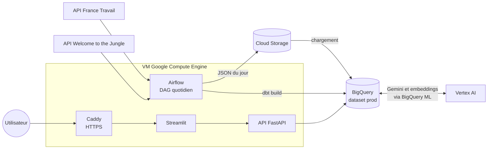

# Job Market Pipeline

Plateforme data de bout en bout sur le marché de l'emploi **Data** en France : collecte quotidienne des offres, enrichissement par IA, entrepôt analytique, observatoire interactif et recommandation d'offres à partir d'un profil ou d'un CV.

Projet réalisé dans le cadre de la formation **Liora Data Engineer RNCP7** (DataScientest). Cadre conceptuel : *Fundamentals of Data Engineering*, Joe Reis & Matt Housley (2022).

**Application en ligne** : https://104-196-49-168.sslip.io

---

## Ce que fait la plateforme

**Observatoire du marché** (5 pages) : volume d'offres, métiers, compétences, salaires, contrats, secteurs, cartes par région et par département. Chaque page est filtrable (métier, région, contrat, plateforme…).

**Recommandation d'offres** (2 pages) :
- **Mon profil** : le candidat dépose son CV (PDF) ; Gemini en extrait les compétences et le métier visé, qui pré-remplissent le formulaire. Le profil est enregistré dans BigQuery.
- **Mes recommandations** : les offres compatibles avec le profil, classées par score de correspondance.

Le périmètre couvre **13 métiers Data** (Data Engineer, Data Analyst, Data Scientist, Analytics Engineer, ML Engineer…).

---

## Architecture



| Couche | Outil | Rôle |
|---|---|---|
| Orchestration | Airflow 3 (Astro) | DAG `job_market_dag`, chaque jour à 00:00 UTC |
| Stockage brut | Cloud Storage (`us-east1`) | Un fichier JSON par source et par jour |
| Entrepôt | BigQuery (multi-région `US`) | Tables brutes, modèles dbt, profils clients |
| Transformation | dbt (moteur Fusion) | Staging → intermediate → marts, une soixantaine de modèles testés |
| IA | Gemini 2.5 Flash et `text-multilingual-embedding-002`, via BigQuery ML | Enrichissement des offres, embeddings, analyse de CV |
| Service | FastAPI | Seul point d'accès aux données pour l'application |
| Interface | Streamlit | Observatoire et recommandation |
| Hébergement | VM GCE `e2-standard-2` (`us-east1`), Docker, Caddy | Airflow, API et Streamlit sur la même machine ; HTTPS Let's Encrypt |

---

## Sources de données

| Source | Accès | Contenu |
|---|---|---|
| **France Travail** | API officielle (OAuth2), mots-clés « data » | Offres publiées la veille |
| **Welcome to the Jungle** | API de recherche (Algolia), offres en France | Offres publiées la veille |

Les API ne renvoient que les offres **encore en ligne** : il est impossible de remonter loin dans le passé. L'historique se constitue jour après jour.

---

## Le pipeline

### 1. Ingestion (Airflow)

Pour chaque source, en parallèle : `fetch_*` (appel de l'API) → `upload_*` (JSON dans GCS) → `has_file_*` (court-circuit si aucune offre ce jour-là) → `load_*_to_bq` (ajout à la table brute). La tâche `dbt_build` s'exécute ensuite, dès qu'au moins une source a été chargée.

- Le run de la date **J** collecte les offres publiées le **jour J−1**, une journée complète.
- Les tâches d'ingestion sont relancées 2 fois en cas d'échec ; `dbt_build` ne l'est pas (une relance rejouerait tout le build, appels Gemini compris).

### 2. Transformation (dbt)

| Couche | Contenu |
|---|---|
| `staging/` | Extraction des champs JSON, typage, dédoublonnage par identifiant |
| `intermediate/france_travail/`, `intermediate/wttj/` | Normalisation par source : ville, département et région (référentiel INSEE), métier, contrat, formation, expérience, salaire, secteur, langues, compétences |
| `intermediate/` | Union des sources (`int_offres`) et détection des doublons entre plateformes (`int_offres_doublons`) |
| `marts/` | Modèle en étoile : `fact_offres`, 10 dimensions, tables de liaison compétences et langues, embeddings, scores de recommandation |

Les seeds (`seeds/`) contiennent les référentiels : communes, départements, régions (INSEE), compétences et barèmes de formation et d'expérience.

### 3. Enrichissement par IA

Quand l'API ne fournit pas une information (ou la fournit mal), Gemini la déduit du texte de l'offre : métier, entreprise, secteur, contrat, formation, expérience, langues et compétences. Les appels passent par `AI.GENERATE_TEXT` dans BigQuery.

Trois règles encadrent ces 10 modèles :
- **File d'attente matérialisée** (`*_a_traiter`) : seules les offres pas encore traitées sont envoyées à Gemini. BigQuery évaluant l'appel à Gemini avant un filtre incrémental placé dans la même requête, ce filtre est calculé dans une table à part (voir `macros/ids_deja_traites.sql`).
- **Reprise automatique** : un appel en erreur (quota, délai) laisse une réponse NULL, et l'offre est renvoyée à Gemini au run suivant.
- **Pas de blocage** : une réponse absente ou hors vocabulaire est remplacée en aval (repli sur l'API ou une regex, `Non Renseigné`, `Autre`). Les tests des sorties brutes de Gemini sont en `warn`, pour qu'une seule mauvaise réponse ne fige pas l'application.

### 4. Recommandation

1. **Filtres stricts** : formation et expérience suffisantes, même contrat, ville et métier choisis, fourchettes de salaire qui se recoupent.
2. **Score** = 62,5 % × part des compétences de l'offre que possède le candidat + 37,5 % × proximité sémantique entre les compétences (embeddings, `VECTOR_SEARCH`).
3. **Dédoublonnage** des annonces republiées.

L'API calcule les recommandations en direct (`api/services/recommandations.py`). Le modèle dbt `bridge_offres_clients` persiste les mêmes scores : les deux doivent rester alignés.

---

## Structure du dépôt

```
├── dags/job_market_dag.py         # DAG Airflow quotidien
├── ingestion/apis/                 # Clients des API France Travail et WTTJ
├── job_market_dbt/                 # Projet dbt (models, seeds, macros, tests)
├── include/dbt/profiles.yml        # Profil dbt utilisé par Airflow
├── Dockerfile                      # Image Airflow (Astro Runtime + dbt Fusion)
├── docker-compose.override.yml     # Montages de la pile Airflow (credentials)
├── api/                            # API FastAPI (routes, services, schémas, SQL d'installation)
├── streamlit-app/                  # Application Streamlit (vues, composants, client d'API)
├── compose.app.yml                 # Pile applicative : API + Streamlit
└── tests/                          # Tests de l'API et de l'application
```

---

## Installation en local

Prérequis : Python 3.13, Docker, [Astro CLI](https://www.astronomer.io/docs/astro/cli/install-cli), un projet GCP avec BigQuery, Cloud Storage et Vertex AI activés.

```bash
git clone https://github.com/hermannagossou/job-market-pipeline.git
cd job-market-pipeline
python -m venv job-market-venv && source job-market-venv/bin/activate
pip install -r requirements.txt

cp .env.example .env                              # renseigner les valeurs
cp credentials.example.json credentials.json      # y coller la clé du compte de service GCP
```

> ⚠️ Ne jamais committer `.env` ni `credentials.json` (ils sont dans le `.gitignore`).

Le compte de service a besoin des rôles **BigQuery Data Editor**, **BigQuery Job User**, **BigQuery Read Session User**, **BigQuery Connection User** (modèles distants), **Storage Object Admin** (buckets des offres et des CV) et **Vertex AI User**. Les modèles distants (`gemini_model`, `embedding_model`) et les tables des profils clients sont créés une fois par `api/sql/setup_bigquery.sql`.

### Pile Airflow

```bash
astro dev start          # UI Airflow : l'adresse est affichée au démarrage
astro dev restart        # après une modification du DAG ou du projet dbt
astro dev stop
```

### Application (API + Streamlit)

```bash
docker compose -f compose.app.yml up -d --build
docker compose -f compose.app.yml ps      # api : healthy, streamlit : running
docker compose -f compose.app.yml down
```

- Application : http://localhost:8501
- Documentation interactive de l'API : http://127.0.0.1:8000/docs

> ⚠️ Toujours passer `-f compose.app.yml` : sans lui, Docker Compose fusionnerait `docker-compose.override.yml`, qui appartient à la pile Airflow.

### dbt en dehors d'Airflow

Le profil `include/dbt/profiles.yml` lit `GCP_PROJECT_ID` et `BIGQUERY_DATASET` dans l'environnement :

```bash
cd job_market_dbt
dbt build --profiles-dir ../include/dbt
```

> ⚠️ Ne jamais lancer `--full-refresh` sur tout le projet en prod : les modèles IA sont incrémentaux, et tout reconstruire renverrait toutes les offres à Gemini. Pour reconstruire un modèle IA, sélectionner aussi sa file d'attente (ex. `-s +int_france_travail_ai_nom_secteur --full-refresh`).

---

## Déploiement (production)

Tout tourne sur une VM Compute Engine (`job-market-vm`, `us-east1-b`, 2 vCPU, 8 Go) :
- **Airflow** via `astro dev start`, relancé automatiquement au redémarrage de la VM ;
- **API et Streamlit** via `compose.app.yml` (`restart: unless-stopped`) ;
- **Caddy** comme reverse proxy : seul point d'entrée public (ports 80 et 443), certificat HTTPS Let's Encrypt renouvelé automatiquement, nom fourni par sslip.io.

L'API et l'UI Airflow n'écoutent que sur la VM elle-même. Pour ouvrir l'UI Airflow depuis un poste ayant accès au projet GCP :

```bash
gcloud compute ssh job-market-vm --zone=us-east1-b --project=job-market-de-492514 -- -L 8080:localhost:8080
# puis http://localhost:8080
```

Les secrets (`.env`, `credentials.json`) sont copiés sur la VM par `gcloud compute scp`, jamais par Git. `credentials.json` est protégé en `600`, avec une ACL qui en autorise la lecture aux seuls utilisateurs des conteneurs (uid 50000 pour Airflow, 1000 pour l'API).

### Mettre à jour la production

```bash
cd ~/job-market-pipeline && git pull --ff-only origin main
astro dev restart                                   # si le DAG ou dbt a changé
docker compose -f compose.app.yml up -d --build     # si l'API ou l'application a changé
```

### Exploitation

- **Relancer un run** : dans l'UI Airflow, sélectionner la tâche, puis « Effacer » avec l'option « En aval ». En cas d'échec répété, mettre le DAG en pause (`astro dev run dags pause job_market_dag`) avant d'investiguer.
- **Une seule pile Airflow à la fois** écrit dans `prod` : une pile locale doit rester arrêtée, ou son DAG en pause.
- **Coûts** : garder une alerte budgétaire sur le projet GCP (Billing → Budgets & alerts). Le compteur Vertex AI (`aiplatform.googleapis.com/publisher/online_serving/model_invocation_count`) permet de suivre les appels Gemini par jour.

---

## Tests

```bash
pip install -r requirements-dev.txt
pytest --ignore=tests/dags
```

Les tests de l'API et de l'application simulent BigQuery et l'API : aucun n'accède aux données réelles. Les tests de données sont ceux de dbt (`dbt build` les exécute).

---

## Équipe

Projet réalisé par une équipe de 3 Data Engineers :

- Hermann AGOSSOU
- Clémence FALLON
- Maxime G.
